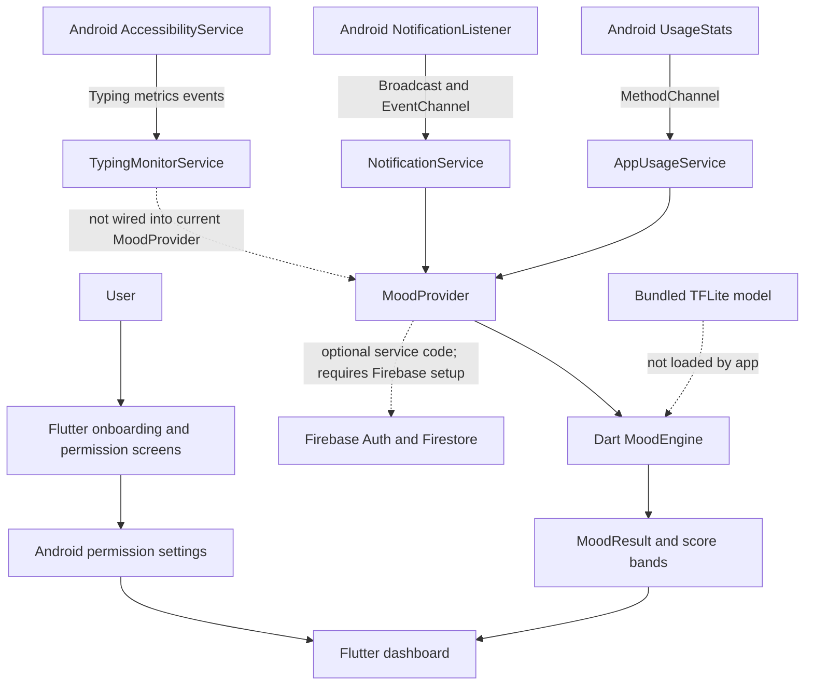

# PRISM

### Personal Real-time Intelligent Sentiment Monitor


PRISM is an Android-focused Flutter prototype for exploring how optional smartphone-activity signals can be presented alongside a simple mood score. It includes onboarding and permission screens, an Android dashboard, native services for app-usage and notification metadata, and a local weighted scoring implementation.

PRISM is an experimental wellness project. It is not a clinical tool, has not been clinically validated, and must not be used to diagnose or treat a mental-health condition.

> **Implementation note:** The current application does not perform NLP or notification sentiment classification. Its active mood calculation is a Dart heuristic. A TensorFlow Lite model asset is present in the repository, but no code loads or runs it. GoEmotions is not included or referenced by the implementation.

## Contents

- [Project goals](#project-goals)
- [Current implementation](#current-implementation)
- [Architecture and workflow](#architecture-and-workflow)
- [Mood scoring](#mood-scoring)
- [Machine-learning assets and datasets](#machine-learning-assets-and-datasets)
- [Technology stack](#technology-stack)
- [Project structure](#project-structure)
- [Requirements](#requirements)
- [Install and run](#install-and-run)
- [Firebase and configuration](#firebase-and-configuration)
- [Build](#build)
- [Screenshots](#screenshots)
- [Privacy and data handling](#privacy-and-data-handling)
- [Limitations and disclaimer](#limitations-and-disclaimer)
- [Future work](#future-work)
- [Contributing](#contributing)
- [License](#license)

## Project goals

PRISM explores a mobile experience for noticing patterns in device use and reflecting on them. Its original product concept describes a personal, real-time sentiment monitor, with goals that include:

- presenting mood-related information in a calm dashboard;
- exploring app-usage, notification-frequency, and typing-pattern signals;
- keeping local scoring on the device where possible; and
- making sensitive Android permissions visible to the user.

These are project goals, not a claim that every proposed capability is implemented. The state of each feature in this repository is summarized below.

## Current implementation

| Area | Status in this repository |
| --- | --- |
| Flutter onboarding, permission setup, theme, and dashboard | Implemented |
| Android app-usage statistics bridge | Implemented; Android Usage Access must be enabled |
| Notification source metadata listener | Implemented for a hard-coded set of messaging/social/work apps; it counts metadata and does not analyze sentiment |
| Accessibility-based typing metrics | Native service and a Flutter metrics service exist; the current mood provider supplies zero-valued typing inputs, so typing is not used in its score |
| Mood score and mood label | Implemented as a weighted, hand-authored Dart heuristic |
| History, insights, and settings | UI files exist, but the route generator currently sends these routes to placeholder screens |
| TensorFlow Lite inference | Not implemented; the model asset is not loaded by application code |
| GoEmotions training or inference | Not present; no dataset, training pipeline, or GoEmotions references were found |
| Firebase sync and cloud prediction | Service scaffolding exists, but Firebase project configuration and a cloud prediction backend are not included; settings currently marks sync as coming soon |

The dashboard contains a weekly chart with fixed sample values. It is a visual placeholder, not a chart generated from stored weekly mood history.

## Architecture and workflow

The app is a Flutter/Dart UI with Riverpod state providers and Android-specific Kotlin services connected through platform channels and broadcasts. The active scoring path uses app-usage and notification-count signals when available. The typing service is present but is not currently connected to the mood provider's scoring inputs.



### Application flow

1. `main.dart` initializes Hive and the permission service, then starts the app inside a Riverpod `ProviderScope`.
2. PRISM shows the splash/onboarding flow unless the onboarding-complete flag is already stored in Hive.
3. The permission screen links to Android settings for Usage Access, notification access, accessibility access, and the standard notification permission.
4. The dashboard refreshes permission state, starts notification metadata collection when access is enabled, and schedules mood calculations at five-minute intervals.
5. The mood provider gathers available app-usage and notification counters, passes them to the Dart scoring engine, and exposes the result to the dashboard.

## Mood scoring

The active implementation is a deterministic heuristic, not a trained classifier. `SignalNormalizer` converts available values into component scores from 0 to 100. `MoodEngine` combines eligible components using the weights below, normalizes by the sum of the weights included for that calculation, rounds the result, and clamps it to 0–100.

| Signal | Weight in code | Runtime status |
| --- | ---: | --- |
| Screen-time score | 25% | Read from Android usage statistics when access is granted |
| Late-night usage score | 15% | Estimated as 20% of total screen time when the calculation occurs between 11 PM and 6 AM; it is not derived from timestamped per-app sessions |
| Typing-speed score | 20% | Provider currently supplies `0.0` |
| Backspace-rate score | 15% | Provider currently supplies `0.0` |
| Notification-frequency score | 15% | Derived from notification counts/rate when the listener is active |
| Messaging-app share score | 10% | Derived from notification category counts when notifications exist |

The engine only includes a component in the weighted mean when its corresponding input is available. Typing components are included only for a positive typing-speed input. The current provider leaves typing speed and backspace rate at zero, and it does not populate app-switch counts.

The `confidence` field is a data-availability heuristic, not a calibrated model probability. It starts at zero when no tracked points are available and otherwise increases according to the number of available signal flags.

The runtime mood category is selected from the final score:

| Score | Runtime label |
| ---: | --- |
| 80–100 | Happy & Relaxed |
| 60–79 | Neutral |
| 40–59 | Stressed |
| 20–39 | Anxious |
| 0–19 | Very Low |

These labels are application display categories. They are not diagnoses or validated assessments.

## Machine-learning assets and datasets

The repository contains the following model-related files:

| Path | Contents | Used by the active scoring path? |
| --- | --- | --- |
| `assets/models/mood_behavior_model.tflite` | TensorFlow Lite model binary (about 56 KB) | No loader or interpreter invocation is present in `lib/` |
| `assets/models/labels.txt` | `Angry`, `Happy`, `Neutral`, `Sad`, `Stressed` | No; the file is not read by the app |
| `assets/models/scaler_params.json` | 20 feature names and associated `mean`/`scale` arrays | No; the file is not read by the app |

The runtime `MoodLabel` enum instead defines `Happy & Relaxed`, `Neutral`, `Stressed`, `Anxious`, and `Very Low`. The bundled asset labels and the runtime score bands are therefore distinct mechanisms; the README does not treat the model asset as an integrated classifier.

No training code, dataset files, model card, provenance, or dataset attribution is included. In particular, **GoEmotions is not used by the implementation evidenced in this repository**, so no dataset split, training setup, or benchmark metrics can be reported.

The `tflite_flutter` package is declared in `pubspec.yaml`, but dependency presence alone does not mean inference is implemented. The current prediction path imports and calls the Dart `MoodEngine` heuristic.

## Technology stack

| Layer | Technology |
| --- | --- |
| UI and app logic | Flutter, Dart (`>=3.0.0 <4.0.0`) |
| State management | `flutter_riverpod` |
| Local onboarding state | Hive and `hive_flutter` |
| Android integration | Kotlin, Android platform channels, UsageStats, Notification Listener, Accessibility Service |
| Local scoring | Dart weighted rules and signal normalization |
| Model artifact | TensorFlow Lite `.tflite` file bundled as an asset; not currently invoked |
| Optional cloud scaffolding | Firebase Core, Firebase Auth anonymous sign-in, Cloud Firestore |
| Android build | Android Gradle Plugin 8.11.1, Gradle 8.14, Kotlin plugin 2.2.20, Java 17 |

Direct Dart dependencies and their declared version constraints are maintained in [`pubspec.yaml`](pubspec.yaml); resolved versions are recorded in [`pubspec.lock`](pubspec.lock). Other declared packages include `fl_chart`, `permission_handler`, `tflite_flutter`, and `cupertino_icons`.

## Project structure

```text
.
├── android/                         Android application and native services
│   └── app/src/main/kotlin/         Platform-channel, accessibility, and notification code
├── assets/models/                   TFLite asset, labels, and scaler metadata
├── docs/                            Local implementation notes (excluded from Git)
├── lib/
│   ├── app/                         App root, routes, and theme
│   ├── ai/                          Rule-based mood engine and cloud service scaffold
│   ├── core/permissions/            Permission state and Android settings bridge
│   ├── features/                    Onboarding, dashboard, tracking, insights, history, settings
│   ├── models/                      Mood result model and runtime mood labels
│   ├── providers/                   Riverpod providers and state notifiers
│   └── services/                    Firebase initialization and Firestore sync
├── test/                            Flutter widget smoke test
├── analysis_options.yaml            Dart analyzer configuration
├── pubspec.yaml                     Package metadata and dependencies
└── pubspec.lock                     Resolved Dart/Flutter dependencies
```

`PRODUCT.md`, `TASK.md`, `TECH_RULES.md`, and `docs/implementation_plan.md` are local planning documents and are excluded by the current `.gitignore`.

## Requirements

- Flutter SDK with Dart 3.x (the package constraint is Dart `>=3.0.0 <4.0.0`).
- Android Studio or the Android command-line toolchain, including an Android SDK and emulator or a physical Android device.
- Java 17 for the configured Android Gradle build.
- Android API level 26 or later, as configured by `minSdk = 26`.

The Android Gradle settings read `flutter.sdk` from `android/local.properties`. That file is machine-specific and ignored by Git; Flutter/Android tooling must generate or configure it for the local SDK installation.

## Install and run

From the repository root:

```bash
flutter doctor
flutter pub get
flutter run
```

Select an Android emulator or connect an Android device with developer options enabled. For Usage Access, notification-listener access, and accessibility access, follow the in-app permission flow and enable each service in Android Settings. These permissions are optional to grant, but related signals will be unavailable when they are not enabled.

The test directory contains a single widget smoke test. To run the project tests:

```bash
flutter test
```

No test or build result is implied by this README.

## Firebase and configuration

There are no environment variables defined by the current repository and no Firebase platform configuration files are included. The Firebase service calls `Firebase.initializeApp()` without explicit `FirebaseOptions`; Android Firebase build-plugin/configuration is not present in the checked-in Gradle setup. As a result, Firebase-backed behavior should be considered unconfigured in a fresh checkout.

To experiment with the existing Firebase scaffolding, configure a Firebase project for the Android app, add the appropriate local platform configuration and build integration, enable anonymous authentication, and define restrictive Firestore security rules. Do not add service-account keys or private credentials to the repository. The Settings UI currently labels data sync as “Coming Soon”; the cloud classes do not constitute a ready-to-use backend.

## Build

Create a debug APK with:

```bash
flutter build apk --debug
```

The Gradle release block currently signs with the debug signing configuration. A release build from this state is not a production or store-ready artifact. Configure a unique application ID, production signing, Firebase setup if needed, and a reviewed privacy/data-retention flow before distribution.

## Screenshots

No application screenshots are currently included in the repository. The Android launcher icons are present under `android/app/src/main/res/mipmap-*`, but they are not screenshots. Add genuine app captures here when they are available.

## Privacy and data handling

PRISM requests access to sensitive Android data sources. Review these behaviors before enabling permissions or distributing the app:

- **Usage access:** the native bridge queries app-usage statistics for a requested time range.
- **Notifications:** the listener filters a hard-coded set of app package names, checks whether notification title/text fields are present, and emits app/category/timestamp/priority metadata. It does not send notification text to the Flutter layer or perform sentiment analysis.
- **Accessibility:** the service observes text-change and selection-change events to calculate typing metrics. It derives values from text-length changes; `canRetrieveWindowContent` is false in the service configuration. The metrics service can retain bounded in-memory event summaries while active.
- **Local state:** Hive stores onboarding/permission-related state. The checked-in code does not show an implemented persistent mood-history database.
- **Cloud:** service code can write mood results/factors and behavioral summaries to Firestore under an anonymous Firebase user ID when configured and invoked. “Anonymous” does not mean that usage data is non-sensitive.

Onboarding copy describes privacy guarantees more broadly than the implementation can establish. This project should not be represented as privacy-certified. A production version would need a complete data inventory, explicit consent and opt-out behavior, data retention/deletion controls, and reviewed backend access rules.

## Limitations and disclaimer

- The app is an experimental prototype; the displayed scores and labels are not validated mental-health measures.
- It does not currently classify notification content, run NLP, or use GoEmotions.
- The TFLite model and scaler files are bundled but are not integrated into the runtime scoring path; their training provenance is undocumented.
- Typing metrics are collected by native/Flutter services but are supplied as zero placeholders to the mood provider.
- Late-night usage is estimated from the current clock time and total daily screen time, not measured from per-session timestamps.
- Insights, history, and settings route to placeholders, despite partial screen files being present. The weekly dashboard chart uses hard-coded sample values.
- Firebase configuration, security rules, and a cloud inference backend are not included.
- Android-specific collection features do not have implementations for iOS, desktop, or web.

PRISM does not provide medical advice, diagnosis, or treatment. Do not use its output to make clinical or emergency decisions.

## Future work

Potential next steps, not implemented features:

1. Document the model's source, training data, label mapping, evaluation, and intended use; add an inference adapter only after verifying the model input/output contract.
2. Decide whether notification text analysis is actually needed. If so, design explicit consent and a privacy-preserving processing path before adding NLP.
3. Connect typing metrics to scoring only with clear consent, testing, and an opt-out mechanism.
4. Replace estimated late-night use and sample chart values with correctly timestamped, persisted data.
5. Complete navigation and implement the Insights, History, and Settings flows, including real data deletion and sync controls.
6. Configure optional Firebase integration with least-privilege Firestore rules, retention limits, and documented data flows.
7. Add tests for scoring boundaries, signal normalization, permission behavior, and cloud serialization.
8. Replace debug signing and the example Android application ID before any release.

## Contributing

Issues and pull requests are welcome. For changes involving permissions, behavioral data, mood scoring, or cloud sync, describe the data affected and update the privacy documentation. Keep claims about datasets, model performance, and user benefit tied to reproducible evidence. Run the relevant analyzer and tests before proposing code changes.

## License

This project is licensed under the [MIT License](LICENSE).
